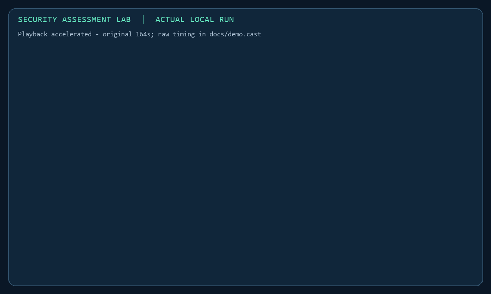
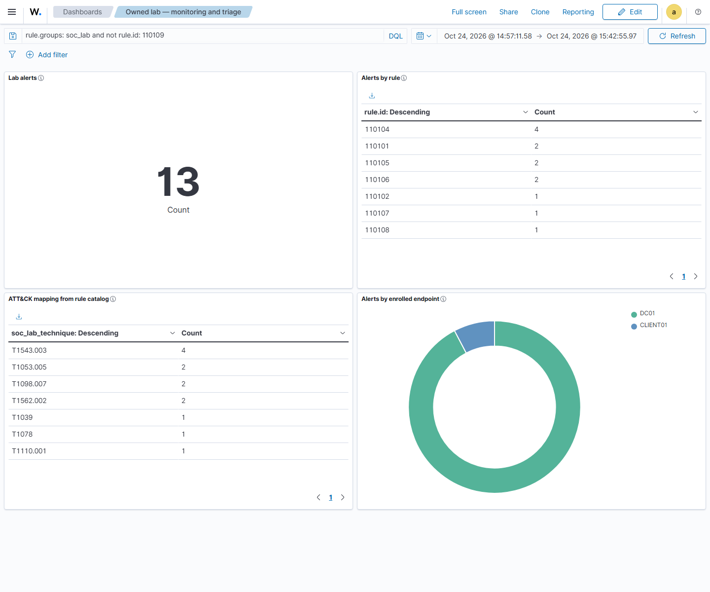
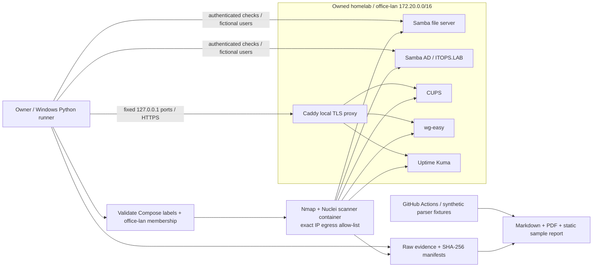

# Security Assessment Lab

I assessed my own simulated office services, fixed verified weaknesses and added a guarded monitoring workflow for investigating account and system changes.



[](https://github.com/iamnajib71/security-assessment-lab/actions/workflows/ci.yml) · [MIT licence](LICENSE)

## At a glance

| Area | Evidence-backed summary |
| --- | --- |
| **The problem** | An office administrator can expose account and file-management services through weak settings; staff access and administration then carry avoidable security risk, while careless fixes can disrupt support. This exercise uses only my owned homelab. |
| **What I built** | I verified and fixed assessment findings, then deployed Wazuh, enrolled my existing Windows domain and client, and built detections, dashboards and evidence-backed SOC triage tickets. |
| **Results** | [3 assessment findings fixed; 0 open confirmed findings](report/security-assessment.md). [7 detections produced 13 native alerts; share-rule replay tuned from 42 alerts to 1](docs/monitoring-status.md). [30 unit tests passed](evidence/monitoring/local-validation.json); existing assessment evidence remains intact. |
| **Skills shown** | Wazuh, SIEM, Sysmon, MITRE ATT&CK, alert triage, detection tuning, security operations, Active Directory, Python, security assessment, Nmap, Nuclei, remediation and regression testing. |
| **Relevant roles** | Junior SOC Analyst, Security Operations Analyst, IT Support Analyst, Junior Security Analyst, Junior Systems Administrator. |
| **How it was built** | Designed, specified and reviewed by me; built with Codex as my coding agent (vibe coding), with every change tested in CI. |
| **Try it / evidence** | [Assessment report](https://iamnajib71.github.io/security-assessment-lab/) · [Monitoring and coverage](#monitoring-and-detection) · [Defender runbook](docs/monitoring.md) · [Raw evidence](evidence/) · [Quick start](#quick-start) |

## Monitoring and detection

I reused my existing Windows domain and Docker office lab, added Wazuh and Sysmon collection, and wrote rules for ordinary account, service, task, policy and file-access events. The [live acceptance record and SOC metrics](docs/monitoring-status.md) state what has actually been captured and tested. [Dashboard definitions](monitoring/dashboards.ndjson), [architecture and safe exercises](docs/monitoring.md), [AD lab reuse](docs/ad-lab-reuse.md), and the [defender evidence register](evidence/monitoring/README.md) explain the workflow and its limits.



[Actual filtered lockout alert](evidence/monitoring/dashboard-lockout.png) · [Captured alerts and source XML](evidence/monitoring/) · [SOC metrics and tuning proof](docs/monitoring-status.md#measured-tuning)

| ATT&CK monitoring hypothesis | Data source | Wazuh rule | Offline field test | Live tested |
|---|---|---|---|---|
| T1098.007 — privileged group addition | Security 4728/4732/4756 | 110101 | Yes | [Yes](docs/tickets/01-privileged-group.md) |
| T1110.001 — lockout indicator | DC01 Security 4740 / CLIENT01 caller | 110102 | Yes | [Yes](docs/tickets/02-account-lockout.md) |
| T1078 — disabled-account sign-in hypothesis | Security 4625 / disabled status | 110103 / 110108 | Yes | [Yes](docs/tickets/03-disabled-sign-in.md) |
| T1543.003 — service creation | DC01 7045/4697 | 110104 | Yes | [Yes](docs/tickets/04-service-created.md) |
| T1053.005 — scheduled task creation | DC01 Security 4698 | 110105 | Yes | [Yes](docs/tickets/05-task-created.md) |
| T1562.002 — audit-policy change hypothesis | DC01 Security 4719 | 110106 | Yes | [Yes](docs/tickets/06-audit-policy.md) |
| T1039 — restricted-share access hypothesis | Security 5145 Audit Failure | 110107 | Yes | [Yes](docs/tickets/07-share-denied.md) |

These are authorised lab events, not attacks. A lockout, disabled sign-in or denied read alone does not establish an ATT&CK technique. [Seven triage tickets](docs/tickets/) record evidence, severity, benign true-positive assessments, actions and lessons. On the same 42 real share events, Wazuh replay removed 41 successful-access false positives and retained the denial. Native acceptance and replay are reported separately. The ATT&CK chart uses the reviewed rule catalog because Wazuh omitted T1098.007 enrichment on the group alerts.

## What I did, step by step

1. Confirmed ownership and limited the target list to the [explicitly allowed homelab services](SECURITY.md).
2. Captured the baseline with bounded scans and authenticated checks, preserving the [raw evidence and provenance](evidence/README.md).
3. Distinguished informational scanner observations from verified findings and explained their practical impact in the [report](report/security-assessment.md).
4. Hardened file-service signing, directory password policy and local administration transport; recorded the [change and rollback procedures](docs/remediation.md).
5. Retested each finding and reran support and directory workflows to detect regressions.
6. Repeated the documented commands from a clean public clone and published the [validation record](docs/validation.md).
7. Reused the existing AD lab, installed signed Windows collectors and safely generated ordinary fictional-account events; captured native alerts while running the lab in memory-limited stages.
8. Triaged seven detection conditions, tuned share-access noise against saved real logs, captured dashboard screenshots and added saved-log checks to CI. [Monitoring acceptance](docs/monitoring-status.md).

## Problems I hit and how I solved them

- **The initial signing check gave a misleading result:** a client preference still allowed mandatory signing, so I replaced that closure check with the actual negotiation required bit plus signed access. [Preserved intermediate evidence](evidence/README.md).
- **The first assessment stopped at a Windows/Linux newline boundary:** retained only completed runs as published evidence and documented the failed attempt. [Provenance](evidence/README.md).
- **Hardening could break routine support:** reran the existing support and directory tests after remediation; both recorded zero failures. [Validation and transcripts](docs/validation.md).
- **Running every lab together put pressure on the PC:** stopped Docker/WSL, introduced resource caps and switched to staged monitoring with the dashboard off during Windows collection. The existing VM startup guard remains in force. [Resource plan and actual acceptance](docs/monitoring.md#running-with-less-pressure-on-a-16-gib-pc).

Native Wazuh testing also exposed rule-linkage and 4740 caller-field mistakes that synthetic checks could not detect. I corrected them against actual agent events before claiming coverage. [Detection lessons](docs/monitoring-status.md).

## Scope and authorization

> **All targets are my own homelab; testing performed by the owner, Nazmul Hassan.**
>
> Only [my IT Support Homelab](https://github.com/iamnajib71/it-support-homelab) and [my Windows AD Lab](https://github.com/iamnajib71/windows-ad-lab). Assessment targets remain the original Docker services and fixed loopback ports. Defender collection adds only DC01 and CLIENT01 on their internal switch; [the exact scope and code guards](docs/monitoring.md#ownership-and-safety-contract) are documented separately.
>
> Defensive work only: no internet targets, third-party systems, exploits, password guessing or denial of service. Every SOC event comes from ordinary administration on fictional lab accounts. The owner-authorised console lockout uses a fixed deliberately wrong value and a five-submission cap; it is not a password search. [Actual operator method and provenance](evidence/monitoring/provenance.json).

The runner derives **five exact IPs** from current Compose labels and network membership. A private IP is never enough: arbitrary addresses, hostnames and CIDRs are refused. Nmap uses those exact IPs, not a `/16` sweep. A scanner-container firewall allows only those five destinations and blocks IPv6. No Docker socket or credentials are mounted into the scanner. Loopback requests use a fixed address/port allow-list, ignore system proxies and reject external redirects. [Safety contract](SECURITY.md).

Tool/template downloads are setup traffic, not internet testing. Homepage is supporting infrastructure and is not scanned. The local TLS proxy is a remediation control checked through the original loopback admin ports.

## Architecture



## Findings summary

[Published assessment evidence](report/security-assessment.md). Baseline: **17 October 2026**; latest retest: **18 October 2026 (Australia/Sydney)**. **5 service hosts; 3 verified findings; 1 Medium, 2 Low; 3 fixed and retested; 0 open confirmed findings.** Informational scanner observations and residual risks are separate from that count.

| ID | Asset | Severity | Verified finding | Status |
|---|---|---|---|---|
| SAL-01 | Samba file server | Medium | SMB signing optional | Fixed - retested |
| SAL-02 | Samba AD | Low | Minimum password age zero permits rapid changes | Fixed - retested |
| SAL-03 | wg-easy / Kuma / CUPS loopback administration | Low | Plaintext HTTP administration (one grouped root cause) | Fixed - retested |

The baseline Nuclei scan returned **20 informational matches**, not 20 vulnerabilities. Public login panels and authenticated company-wide shares are not treated as auth bypasses. Guest share reads and Bob's Finance access were denied. Generated fictional-user credentials were not weak/common defaults. Ratings are **CVSS-style qualitative priorities**, with local prerequisites and limits explained; no invented numeric CVSS scores or unverified CVE claims.

## Before and after: SMB signing

| Proof | Before | After |
|---|---|---|
| Live Nmap `smb2-security-mode` | `Message signing enabled but not required` | `Message signing enabled and required` |
| Persistent fileserver configuration | Signing optional | `server signing = required` |
| Independent SMB2 negotiation | Baseline policy recorded by Nmap | Required bit set (`SecurityMode = 3`) |
| Service health | Alice allowed; Bob denied Finance | Signed Alice access works; Bob still denied |

The original `smbclient signing=disabled` preference still connected after hardening because this client honors mandatory server signing. That was **not** an unsigned-session bypass. The final retest reads the actual SMB2 negotiation bit and checks signed access. [Evidence provenance](evidence/README.md) preserves the intermediate result and correction.

Other fixes persist a one-day AD minimum password age and TLS on the same loopback admin ports, using an explicit local CA. Internal Compose-network HTTP remains a residual risk. The homelab's support and AD regression suites both pass with **zero failures** before and after. [Change record and rollback](docs/remediation.md).

## Quick start

Requires Windows PowerShell, Python **3.12+**, Docker Desktop with Linux containers, and your already-provisioned **owned** `it-support-homelab` at the path below. Bootstrap that dependency using [its README](https://github.com/iamnajib71/it-support-homelab#run-it) first. Existing data volumes and generated credentials are retained. No paid tools or API keys.

Run from a new clone in PowerShell:

```powershell
git clone https://github.com/iamnajib71/security-assessment-lab.git
cd security-assessment-lab
$Lab = 'H:\My Projects - IT\it-support-homelab'
python -m venv .venv
.\.venv\Scripts\python.exe -m pip install -r requirements.txt
docker compose --project-directory $Lab up -d --build --wait --wait-timeout 180
docker build -t security-assessment-scanner:1 .
.\.venv\Scripts\python.exe scripts/remediate.py --lab $Lab
.\.venv\Scripts\python.exe scripts/assess.py --lab $Lab --phase retest
.\.venv\Scripts\python.exe -m unittest discover -s tests -v
.\.venv\Scripts\python.exe scripts/verify_evidence.py
```

Open `report/security-assessment.md` or `report/security-assessment.pdf`. Each run writes a new timestamped `evidence/` directory. Nothing is uploaded by the assessment. The published sample is static; no live scanner is hosted.

These commands passed from a fresh GitHub clone on 18 October 2026: [validation record and raw run](docs/validation.md).

`scripts/remediate.py` applies only the three documented hardening changes to the owned lab and updates its PowerShell HTTP checks to validate the explicit local CA. It is safe to repeat and never seeds vulnerable settings. Local backups are ignored in `private/`. Browser trust is a separate choice; CLI checks use the exported public CA without `--insecure`.

For the standard sibling layout, `make assess` or `python scripts/assess.py --phase retest` runs recon → scan → checks → report after the scanner image is built. On an **unmodified** owned homelab, use `--phase baseline` before remediation to capture your own before state. Never weaken a fixed lab just to replay the demonstration. Existing historical evidence is retained and clearly dated.

Nuclei is used instead of Greenbone because four pinned, reviewed community GET templates make a lightweight, repeatable local pass. It runs unauthenticated; SMB/AD and the homelab regression checks supply authenticated coverage. [Template selection and limits](templates/README.md).

## Project structure

```text
scripts/           scope validation, live runner, remediation, parsers, report + demo tools
templates/         four pinned community templates + upstream licence
monitoring/        pinned Wazuh configuration inputs, rules, Sysmon policy and dashboards
evidence/          actual scans, inventories, manual proofs, integrity manifests
report/            Markdown, PDF, normalized findings, static HTML sample
docs/              manual procedure, change record, source patch, demo, social card
tests/fixtures/    explicitly synthetic parser data; never live evidence
.github/workflows/ fixture/unit/report CI and static report publication
```

## Honest limits

- Owner-performed, small self-assessed lab with known tools; **not evidence of paid penetration testing, OSCP-level exploitation, or production SOC/incident-response experience**.
- Five service containers; top 1,000 TCP ports plus the known wg-easy admin port and fixed loopback ports. No UDP sweep, broad CVE coverage, destructive exploits, password cracking or AD attack-chain validation.
- Four Nuclei templates are deliberately narrow. No matches would not mean “secure”; header/panel matches do not establish compromise.
- Samba AD is not Windows Server. Group/SDDL review is not exhaustive effective-ACL or GPO analysis. Rapid changes were demonstrated; a full password-history bypass was not.
- Loopback TLS is fixed; HTTP inside `office-lan` remains. Local CA trust is explicit. Docker/host administrators remain privileged.
- Older image/release tracks need compatibility and patch review. Nmap's Samba version guess differed from `smbd --version`; runtime evidence takes precedence. No version-only CVE finding is asserted. [Official release references](evidence/version-reference.json).
- Original lab constraints still apply: separate Samba/AD accounts, simulated laser printer, no production VPN deployment or implemented scheduled backups.
- Defender evidence covers seven controlled conditions on two Windows guests. Docker logs are bounded exports of existing stdout/stderr, not full application auditing. [Monitoring limits and replay method](docs/monitoring-status.md#honest-limits).

## Built by Nazmul Hassan

[LinkedIn](https://www.linkedin.com/in/iamnajib71) · [GitHub](https://github.com/iamnajib71)
