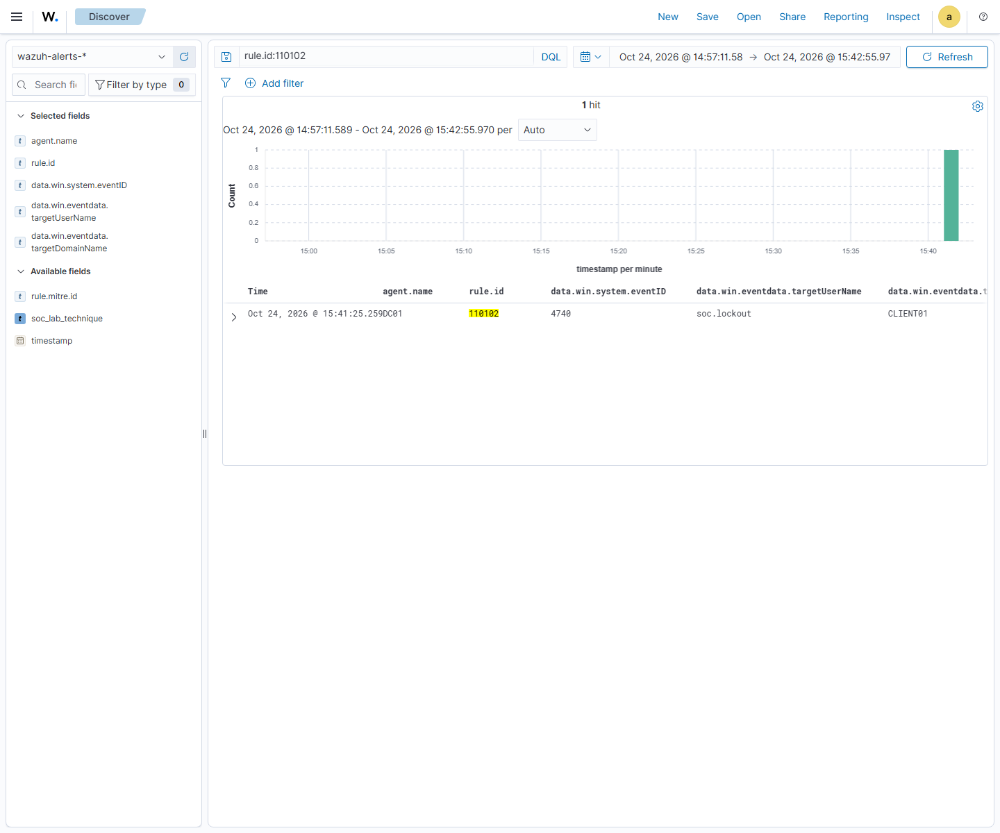

# Monitoring acceptance, ATT&CK coverage and SOC metrics

Seven detection conditions produced **13 actual native Wazuh alerts** from the two owned Windows agents. These are benign lab administrative events, not attacks or customer incidents.

Alert-ingestion window: `2026-10-24T03:57:12.589+0000` to `2026-10-24T04:42:54.970+0000`. Windows source times are preserved separately. Agents buffered events while the manager was off to reduce host memory pressure.

| ATT&CK monitoring hypothesis | Data source | Rule | Offline field replay | Native alert tested | Triage |
|---|---|---|---|---|---|
| [T1098.007](https://attack.mitre.org/techniques/T1098/007/) — Privileged group membership added | Security 4728/4732/4756; privileged group SID | 110101 | Yes | Yes | [2 alert(s)](tickets/01-privileged-group.md) |
| [T1110.001](https://attack.mitre.org/techniques/T1110/001/) — Fictional account locked out | DC01 Security 4740; caller CLIENT01 | 110102 | Yes | Yes | [1 alert(s)](tickets/02-account-lockout.md) |
| [T1078](https://attack.mitre.org/techniques/T1078/) — Disabled fictional account sign-in | Security 4625; status/substatus C0000072 | 110103 / 110108 | Yes | Yes | [1 alert(s)](tickets/03-disabled-sign-in.md) |
| [T1543.003](https://attack.mitre.org/techniques/T1543/003/) — Service installed on DC01 | System 7045 / Security 4697 | 110104 | Yes | Yes | [4 alert(s)](tickets/04-service-created.md) |
| [T1053.005](https://attack.mitre.org/techniques/T1053/005/) — Scheduled task registered on DC01 | Security 4698 | 110105 | Yes | Yes | [2 alert(s)](tickets/05-task-created.md) |
| [T1562.002](https://attack.mitre.org/techniques/T1562/002/) — Audit policy changed on DC01 | Security 4719 | 110106 | Yes | Yes | [2 alert(s)](tickets/06-audit-policy.md) |
| [T1039](https://attack.mitre.org/techniques/T1039/) — Restricted lab share access denied | Security 5145 Audit Failure; SocRestricted share | 110107 | Yes | Yes | [1 alert(s)](tickets/07-share-denied.md) |

## SOC metrics

| Detection | Actual native alerts | Disposition |
|---|---|---|
| 110101 — Privileged group membership added | 2 | Benign true positive |
| 110102 — Fictional account locked out | 1 | Benign true positive |
| 110103 — Disabled fictional account sign-in | 1 | Benign true positive |
| 110104 — Service installed on DC01 | 4 | Benign true positive |
| 110105 — Scheduled task registered on DC01 | 2 | Benign true positive |
| 110106 — Audit policy changed on DC01 | 2 | Benign true positive |
| 110107 — Restricted lab share access denied | 1 | Benign true positive |

13 alerts cover 7 review conditions; alert counts are not incident counts. Native 4697/7045 and approved retests can create multiple alerts for a single type of change. Two native Sysmon process-event samples are retained separately and excluded from these detection totals.

## Measured tuning

The same **42 actual saved 5145 events** were passed through Wazuh logtest: **42 before → 1 after**. The broad rule counted **41 successful authorised accesses** as false positives for the intended denial condition. Failure-only tuning retained **1 of 1 denials**.

This is a reproducible before/after replay, not a claim about two production observation periods. A temporary JSON-to-Windows group bridge checks Wazuh conditions after decoding; native EventChannel acceptance is established independently by the real agent alerts above. The temporary rule is removed and production XML restored after replay.

[Engine results](../evidence/monitoring/engine-tuning.json) · [Before output](../evidence/monitoring/engine-before.txt) · [After output](../evidence/monitoring/engine-after.txt) · [Before rules](../evidence/monitoring/rules-before-tuning.xml)

## Actual screenshots

The [final console test screenshot](../evidence/monitoring/console-final-test-failure.png) shows the fifth generic failure message. Lockout is established by AD state and event 4740, not by relabelling that screenshot as an explicit lockout message.

## Honest limits

- This is a small owned lab; no production SOC experience or adversary emulation is claimed.
- Disabled sign-in, account lockout and denied share access do not establish successful T1078, T1110.001 or T1039 activity. No exploits, password search or denial of service were used.
- Docker collection is a validated host-side export of existing stdout/stderr, not full Samba object auditing, CUPS job auditing or WireGuard per-peer telemetry. A Windows-reserved port prevented restarting Samba AD; the existing containers remained stopped for collection.
- The Docker bridge has tightly bound ingress and a source allow-list; it does not claim network-level egress isolation. The collector and exercise targets are pinned in code.
- The bundled Wazuh ATT&CK enrichment omitted T1098.007 on the captured group alerts. The dashboard explicitly derives its technique labels from the reviewed rule catalog; original alerts are preserved unchanged.
- The low-memory stack is below normal production sizing. Agents and the manager ran in stages; source and ingestion timestamps differ. Both guests are saved outside lab sessions.
