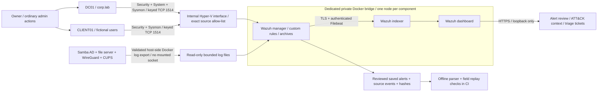

# Monitoring and detection runbook

This defender extension uses free Wazuh on the owner's two existing labs. It
adds event collection, rule engineering, alert review and replay checks. See
the evidence register for the distinction between implemented conditions,
Wazuh engine tests and actual indexed alerts. A passing synthetic unit test
does not establish that an endpoint generated or delivered an event.

## Ownership and safety contract

- Docker lab: `H:\My Projects - IT\it-support-homelab`; Compose project
  `it-support-homelab`, network `office-lan`, subnet `172.20.0.0/16`.
- Hyper-V lab: `H:\My Projects - IT\windows-ad-lab`; internal switch
  `WindowsADLab-Internal`, domain `corp.lab`, **DC01 and CLIENT01 only**.
- No internet targets, third-party systems, exploits, password guessing or
  denial of service. Installer/image acquisition from official publishers
  is setup traffic, not target testing.
- Only normal administrative actions on fictional lab accounts are used.
  Names are fixed: `soc.privilege`, `soc.lockout`, `soc.disabled`, `soc.share`.
  Real people, real credentials and customer data are outside scope.
- `monitoring-host.ps1` verifies both VM names, their single internal-switch
  NIC and lab virtual-disk paths before any operation. PowerShell Direct
  avoids exposing a remote shell on the network. Guest code verifies its
  computer name and domain. The collector verifies Compose project, service,
  working directory, network and address before reading a container log.
- Wazuh uses a dedicated private bridge (`172.29.77.0/24`); dashboard, indexer and API administration bind
  only to loopback. Agent traffic binds only to `192.168.77.1:1514` and host
  firewall rules allow DC01 and CLIENT01's verified current address, with
  explicit deny ranges for every other IPv4 source. No IPv6 binding, port
  forwarding, UDP syslog listener or automatic enrolment listener is supplied.
- Agent keys are imported locally through PowerShell Direct. Port 1515 stays
  unpublished and enrolment is disabled after installation. Active response
  is disabled: alerts never automatically disable accounts or change firewalls.
- Credentials live in ignored `.env`; certificates, private keys, installer
  files and unreviewed telemetry live in ignored `private/monitoring/`.
  Never commit `.env`, `CLAUDE.md` or `AGENTS.md`.

## Architecture



## Running with less pressure on a 16 GiB PC

The full stack and both Windows guests should **not** run throughout the build.
The validated workflow uses phases:

1. Keep both Hyper-V guests off. Start Docker, stop only separately approved
   unrelated workloads, generate certificates and bootstrap the manager on
   loopback. Register the two fixed agents and save their keys privately.
2. Stop Docker and shut down its idle WSL VM. Start the Windows guests with
   the AD lab's existing free-memory/disk guard. Install and configure agents
   sequentially. Preserve events while the dashboard and indexer are off.
3. During native agent delivery, run only the manager and the required guests.
   Check free host memory before each step; retain at least 1.5 GiB. Save the
   client first if more headroom is needed. Agents can reconnect; do not
   silently claim that an offline buffered event was delivered.
4. Export and hash captured events. Save the guests, then start the indexer
   and dashboard for review and real screenshots. Stop the stack afterward.

For this session the previously absent `%USERPROFILE%\.wslconfig` was created
with a **3 GiB RAM, two-processor and 1 GiB swap** cap for dashboard work, tightened
to **1.5 GiB** for manager-only native delivery, plus gradual memory
reclamation. It takes effect only after a full WSL shutdown. It affects all
WSL2 distributions. The cap can be removed by restoring the original absent
configuration once Docker/WSL are stopped. Container limits are separate:
manager 768 MiB / 0.75 CPU, indexer 1,536 MiB / 0.75 CPU with a 512 MiB JVM,
dashboard 768 MiB / 0.5 CPU. These are small lab budgets, below Wazuh's normal
full-stack recommendation; startup is slower and must be observed. No
production capacity claim is made. Containers do not auto-start at login.

Docker 29 recorded but did not actually publish the manager ports on an
`internal` bridge. Native agent connection tests exposed this. The deployment
therefore uses the dedicated private bridge with pinned host bindings and the
exact-source Windows firewall. It does not claim network-level egress isolation:
software-acquisition traffic uses the host and passive collection scripts accept
only the two owned labs. Online vulnerability feeds and active response are off.

## Setup and operation

Use Python 3.12+, Docker Desktop with Linux containers, and elevated Windows
PowerShell 5.1 for the host script. Existing labs must already be provisioned.
Do not rerun their OS/domain bootstrap stages.

Phase 1, with the guests off and Docker running under its resource cap:

```powershell
.\.venv\Scripts\python.exe -m pip install -r monitoring\requirements.txt
.\.venv\Scripts\python.exe scripts\monitoring_setup.py prepare
.\.venv\Scripts\python.exe scripts\monitoring_setup.py bootstrap
.\.venv\Scripts\python.exe scripts\monitoring_keys.py
```

Download the official `wazuh-agent-4.14.9-1.msi` from
`https://packages.wazuh.com/4.x/windows/wazuh-agent-4.14.9-1.msi` and
[Microsoft Sysmon.zip](https://download.sysinternals.com/files/Sysmon.zip), saving
the MSI as `private/monitoring/downloads/wazuh-agent.msi` and extracting
`Sysmon64.exe` beside it. Enrolment checks each file's Authenticode signature and
expected publisher; never substitute an unsigned file.

Phase 2, **stop Docker Desktop and its idle WSL VM first**. Run host actions from
elevated Windows PowerShell. The existing startup guard can refuse a combined
start; use StartDC, then StartClient only when sufficient headroom is available.

```powershell
.\scripts\monitoring-host.ps1 -Action Inspect
.\scripts\monitoring-host.ps1 -Action Start
.\scripts\monitoring-host.ps1 -Action Enroll
.\scripts\monitoring-host.ps1 -Action Firewall
.\scripts\monitoring-host.ps1 -Action PrepareExercises
.\scripts\monitoring-host.ps1 -Action Exercise
# Perform only the owner-authorised, capped console exercise below.
.\scripts\monitoring-host.ps1 -Action Export
.\scripts\monitoring-host.ps1 -Action SaveClient
.\scripts\monitoring-host.ps1 -Action SaveDC
```

Phase 3: start only the manager under the 1.5 GiB WSL cap, using the normal
`compose.json` after the exact-source firewall is installed. Resume DC01, verify
native delivery, save it, then resume CLIENT01 and verify delivery. Save both
before starting the indexer/dashboard. `monitoring_setup.py deploy` validates
the private bridge, pinned images, local bindings, resource limits and firewall
record before starting the full stack. It is for the dashboard phase, rather
than running every VM/container together throughout setup.

After capture, stop Docker again before guest cleanup. `Cleanup` retains the
agents/audit prerequisites, removes only fictional exercise resources and writes
postchecks. Save the guests afterward. Collect existing Docker logs with
`python scripts/monitoring_collect.py --since 36h`; narrower windows are suitable
when the lab has been active recently. Validate the exact native events with
`python scripts/monitoring_evidence.py`. The historical observation period is
explicit in the evidence rather than silently presented as current activity.

Enrolment requires the official signed Windows MSI and Sysmon64.exe in
`private/monitoring/downloads/` and one key file per named agent. Existing
Wazuh/Sysmon installations are not overwritten; inspect and merge them first.
Preparation refuses pre-existing exercise accounts, OU, share, service or
task names. Failed steps require inspecting the private result before retrying.
Credentials and service command lines must never be pasted into public issues.

## Safe exercises and triage

| Detection | Normal lab action | Verify and respond |
|---|---|---|
| Privileged group addition | Add disabled `soc.privilege` to Domain Admins and immediately remove it in `finally` | Inspect group SID, member SID, actor, timestamp and approved change. Confirm removal and that the account remained disabled. |
| Account lockout | Owner-authorised virtual keyboard input at CLIENT01's sign-in screen: one fixed wrong test value, at most five submissions, inspect every outcome | Correlate DC01 event 4740, CLIENT01 caller and failed console logons. In this schema the caller is XML `TargetDomainName`. No password search or authentication API loop is used. The dedicated account is deleted after capture. |
| Disabled-account sign-in | One ordinary Run As attempt with the known password for disabled `CORP\soc.disabled` | Inspect 4625 status/substatus `0xc0000072`; do not confuse a bad password with a disabled account. Leave the account disabled. |
| New service | Register demand-start `SocLabDemo`; never start it; remove it in `finally` | Review 7045/4697 image path, startup type, actor and change. Confirm the service is absent after cleanup. |
| Scheduled task | Register future-dated `SocLabDemo` running `whoami.exe`, then remove it immediately | Review 4698 task XML, principal, executable and trigger. Confirm it never ran and is absent. |
| Audit policy change | Back up audit policy, enable additional Other Logon/Logoff auditing, restore the saved policy | Inspect 4719 subcategory and change. Enabling auditing is benign; the ATT&CK hypothesis concerns malicious impairment. Compare policy with the saved baseline. |
| Restricted share denial | One ordinary attempt to read `\\DC01.corp.lab\SocRestricted\example.txt` as `soc.share` | Inspect Audit Failure 5145, share, requested access and user. Verify denial is at the share ACL; 5145 does not prove an NTFS-only denial. Retain permissions. |

Every ticket records the actual alert ID, timestamp, source record ID and evidence
path before a disposition is assigned. An accurately detected authorised change
is a **benign true positive** for the event condition, not a confirmed attack.
Successful authorised share reads counted by the broad pre-tuning rule are
false positives for the intended *access denied* condition. No incident is
automatically closed merely because its account name starts with `soc.`.

ATT&CK labels identify monitoring hypotheses. A lockout alone does not establish
T1110.001 password guessing; a disabled sign-in does not establish successful
T1078 valid-account abuse; a denied share read does not establish T1039 collection.
This lab never performs those attacks. Audit policy is the selected alternative
to Group Policy change; full GPO monitoring is not claimed.

## Rule replay, tuning and metrics

`monitoring/local_rules.xml` retains the upstream rules and uses custom IDs in
the 100000–120000 range. Disabled sign-in has two status-field variants;
110108 rolls into detection 110103. Context-only Sysmon rule 110109 is counted
separately from the seven incident-review conditions.

`soc_rules.py` reads the same XML and fails on unsupported rule semantics.
Synthetic fixtures exercise positive and negative field conditions. The parser
also normalizes saved Windows XML for offline review. It does **not** implement
Wazuh's EventChannel decoder, rule precedence or correlations. Wazuh engine
replay and actual native-agent alert acceptance are recorded separately.

The tuning comparison uses the **same saved real 5145 events** with a broad
before rule and the failure-only after rule. Report both counts, successful
events removed, failures retained and the observation window. Do not substitute
the synthetic two-record test counts for live noise reduction. Successful
access remains in archives. No blanket user, administrator or lab-account
exclusion is used.

Import `monitoring/dashboards.ndjson` through Dashboard Management → Saved
Objects. Open **Owned lab — monitoring and triage**. It contains actual indexed
lab alert totals, counts by rule, endpoint and ATT&CK hypothesis. Use Discover
with `rule.groups: soc_lab`, then expand an alert to inspect `data.win` and
follow its source record into the ticket. Set a fixed UTC time window before
capturing screenshots so their counts can be reconciled with the evidence.

Container collection currently reads bounded stdout/stderr for four verified
services. Samba file-audit, CUPS access/error files and WireGuard per-peer
handshakes are **not inferred** from a successful log export. If a service logs
only startup messages, record that limitation. WireGuard keys/configurations
are deliberately excluded. No Docker socket is mounted inside Wazuh.

The executed collection read stopped containers' existing logs. Windows reserved
port 1636, preventing the Samba AD container from restarting, so no ports or
assessment configuration were changed. Wazuh archived 749 directory, 12 file
server, 46 WireGuard and 12 CUPS records. This is log-transport evidence, not proof
of complete file, print-job or peer-handshake auditing. Source timestamps and
collection time remain distinct.

The final cleanup retains required monitoring audits and the agents, removes the
four fictional exercise accounts/share, and checks domain membership and existing
department shares. `C:\SocLab\audit-original.csv` is an explicit rollback option;
restoring it can remove audit prerequisites. The audit-policy exercise restores
its own separate snapshot, rather than switching off the monitoring baseline.

The optional capture helper uses installed Chrome and Playwright (`PLAYWRIGHT_MODULE`
can name its module path). It verifies the generated CA and `wazuh.dashboard`
certificate identity before browser capture, restricts requests to loopback,
keeps cookies in ignored private storage, and captures actual rendered charts.
The ATT&CK chart derives labels from the catalog because native enrichment omitted
T1098.007. The native alert JSON remains unchanged.

## References

- [Official Wazuh Docker deployment](https://documentation.wazuh.com/current/deployment-options/docker/wazuh-container.html)
- [Pinned upstream deployment source](https://github.com/wazuh/wazuh-docker/tree/56ece955b1107b7b62823afae5b7057e1dab9d98/single-node)
- [Custom Wazuh rules](https://documentation.wazuh.com/current/user-manual/ruleset/rules/custom.html)
- [Windows EventChannel collection](https://documentation.wazuh.com/current/user-manual/capabilities/log-data-collection/configuration.html)
- [Microsoft Sysmon](https://learn.microsoft.com/sysinternals/downloads/sysmon)
- [Microsoft 5145 and share-level failure limits](https://learn.microsoft.com/en-us/previous-versions/windows/it-pro/windows-10/security/threat-protection/auditing/event-5145)
- [Wazuh EventChannel logtest limitation](https://github.com/wazuh/wazuh/issues/13715)
